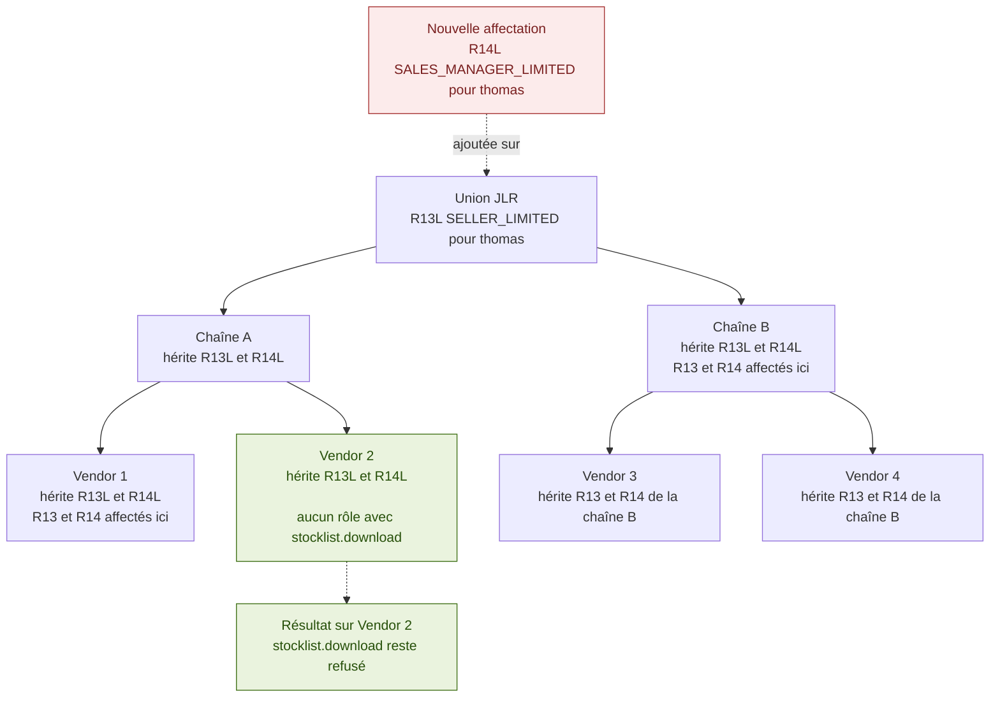
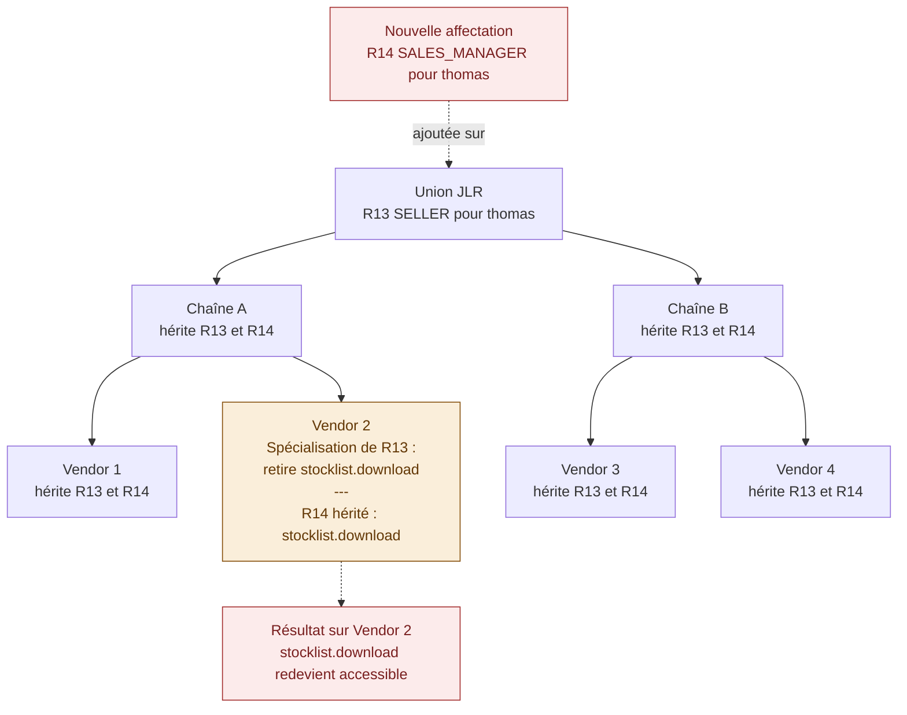
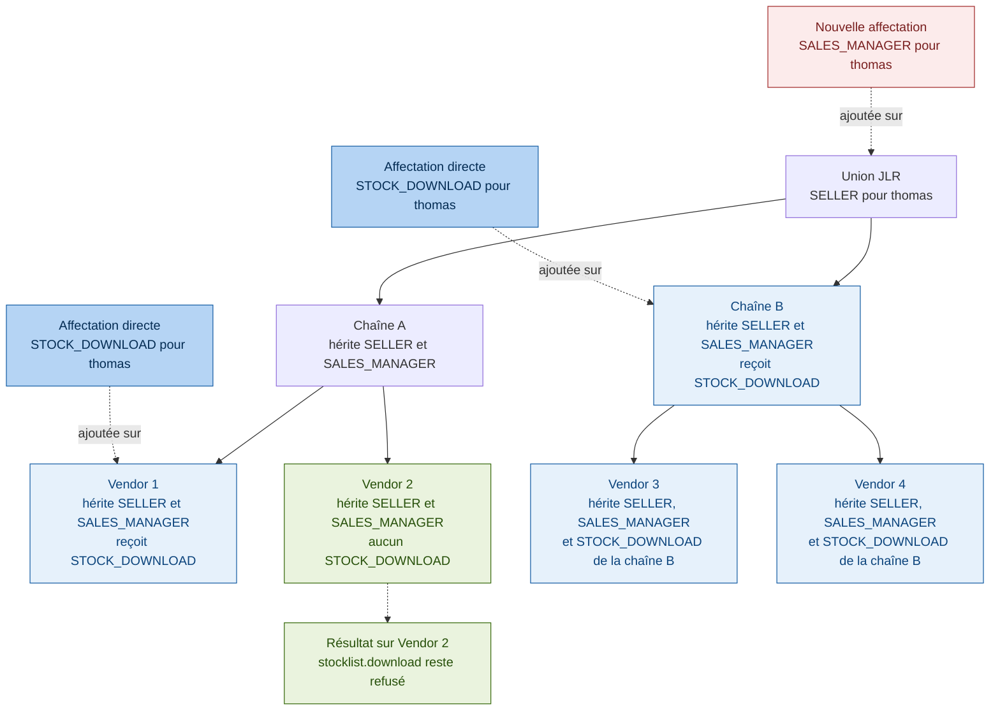
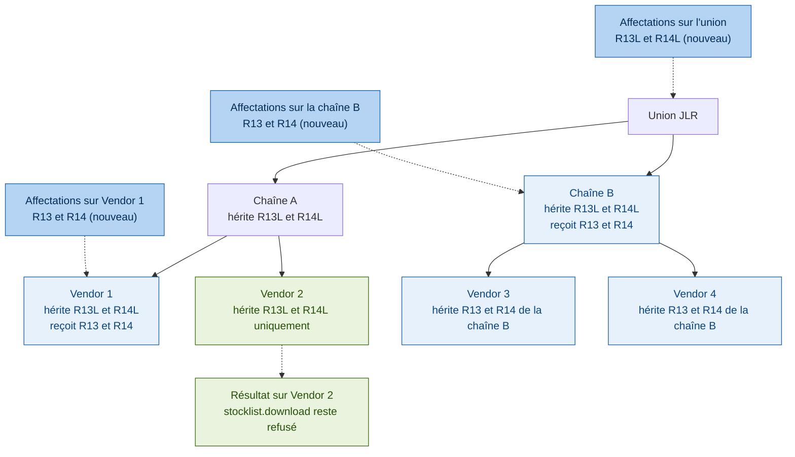
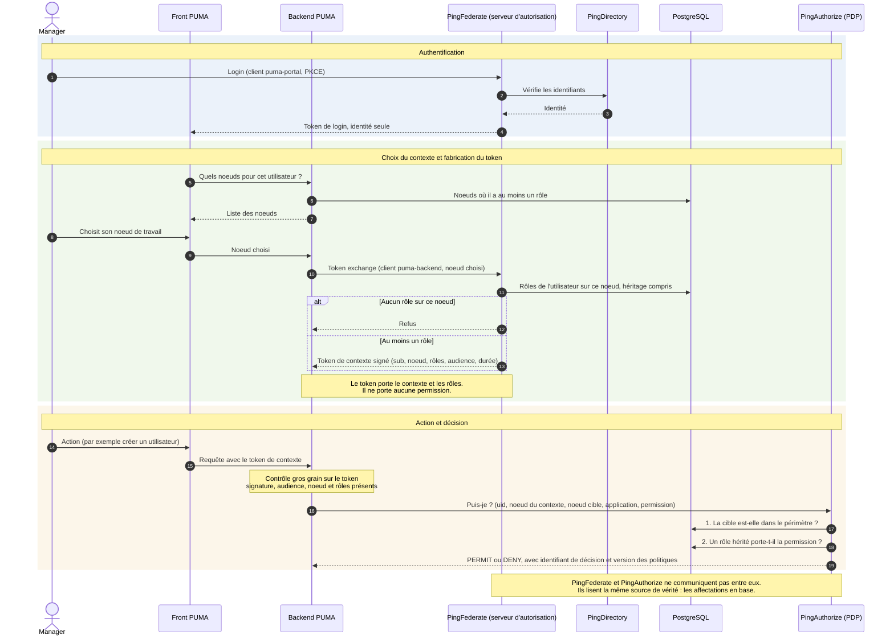
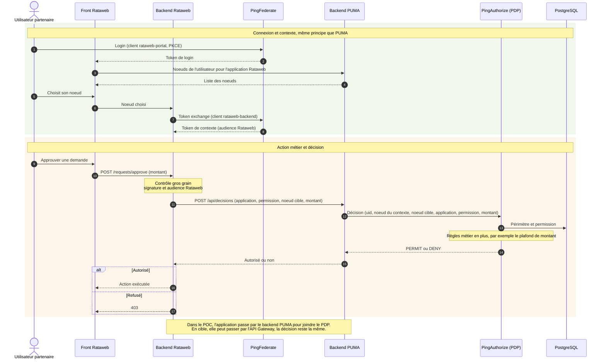

# Solution : restreindre en choisissant où l'on affecte

On reprend exactement les mêmes données que dans le problème. R13 SELLER et R14 SALES_MANAGER contiennent tous les deux stocklist.download, et Vendor 2 ne doit pas l'avoir.

Il n'y a plus de spécialisation ni de retrait. Une affectation reste simple : un utilisateur, un rôle et un noeud, valable pour ce noeud et tous ses descendants. Chaque rôle qui contient une permission à restreindre existe aussi en version limitée, sans cette permission.

La règle est la suivante : au-dessus d'un noeud restreint, on n'affecte que la version limitée. La version complète est affectée plus bas, uniquement sur les noeuds où elle est autorisée. Vendor 2 ne reçoit donc la version complète ni de son parent ni de l'union.

La nouvelle affectation de R14 suit la même règle que R13 : R14L sur l'union, R14 complet sur la chaîne B et sur Vendor 1. Le contenu de R14 ne change pas, seul l'endroit où on l'affecte compte.

## Illustration

Même hiérarchie et même nouvelle affectation que dans le problème. En rouge, la nouvelle affectation. En vert, le noeud protégé et le résultat.

Vendor 1 reçoit R13 et R14 par une affectation directe. Ils ne viennent pas de la chaîne A, sinon ils descendraient aussi sur Vendor 2.

## Rôles et permissions

| Code | Rôle | Permissions |
|---|---|---|
| R13 | SELLER | stocklist.download, quote.create, customer.edit |
| R13L | SELLER_LIMITED | quote.create, customer.edit |
| R14 | SALES_MANAGER | stocklist.download, request.approve |
| R14L | SALES_MANAGER_LIMITED | request.approve |

R13 et R14 sont identiques à ceux du problème. R13L et R14L sont des codes proposés.

## Affectations de thomas

| Rôle | Noeud | Portée |
|---|---|---|
| R13L | Union JLR | Tous les points de vente de l'union |
| R13 | Chaîne B | Vendor 3, Vendor 4 et les futurs points de vente de la chaîne B |
| R13 | Vendor 1 | Vendor 1 uniquement |
| R14L | Union JLR | Tous les points de vente de l'union (nouvelle affectation) |
| R14 | Chaîne B | Vendor 3, Vendor 4 et les futurs points de vente de la chaîne B (nouvelle affectation) |
| R14 | Vendor 1 | Vendor 1 uniquement (nouvelle affectation) |

## Ce qui se passe sur Vendor 2

| Étape | Rôles reçus sur Vendor 2 | stocklist.download |
|---|---|---|
| Problème, après l'affectation de R14 | R13 spécialisé et R14 complet | Autorisé |
| Solution, après l'affectation de R14 | R13L et R14L | Refusé |

## Ce que la solution demande

La restriction ne repose plus sur un mécanisme caché mais sur l'endroit où l'on affecte. Ce que l'on lit dans les affectations correspond exactement à ce que l'utilisateur obtient.

En contrepartie, affecter par erreur R14 complet sur l'union redonnerait le téléchargement sur Vendor 2. Ce ne serait plus un contournement silencieux mais une affectation visible, que l'écran d'affectation peut signaler en affichant les noeuds concernés.

Un point de vente ajouté plus tard sous la chaîne A ne reçoit que les versions limitées tant qu'on ne lui affecte pas les rôles complets. Le comportement est donc fermé par défaut.

Le coût dépend du nombre de restrictions qui existent réellement, chiffre à confirmer avec le métier.

Les permissions sont simplifiées pour l'exemple et seront alignées sur le catalogue réel.

7# Problème : l'héritage contourne les restrictions

## En bref

- Un rôle affecté sur un noeud s'applique à tous ses descendants. C'est voulu : une seule affectation sur l'union couvre tous ses points de vente, y compris les futurs.
- Pour retirer une permission sur un point de vente précis, la spec prévoit une spécialisation du rôle sur ce noeud. Par exemple, R13 SELLER spécialisé sur Vendor 2, sans stocklist.download.
- Cette restriction est attachée à un rôle, pas au noeud. Elle ne protège donc que contre ce rôle.
- Si on affecte plus tard sur l'union un autre rôle qui porte la même permission, ce rôle descend complet jusqu'à Vendor 2, et les permissions s'additionnent.
- Résultat : l'utilisateur retrouve stocklist.download sur Vendor 2, alors que personne n'a modifié la restriction. Le contournement ne vient pas d'une erreur de saisie, il découle mécaniquement du modèle.
- Le même effet se produit si une permission est ajoutée plus tard à un rôle global : elle descend sur tous les noeuds spécialisés qui ne l'ont pas explicitement retirée.

## Illustration

En rouge : la nouvelle affectation et son effet. En orange : le noeud spécialisé.

## Rôles et permissions de l'exemple

| Rôle | Permissions |
|---|---|
| R13 SELLER | stocklist.download, quote.create, customer.edit |
| R14 SALES_MANAGER (nouvelle affectation) | stocklist.download, request.approve |
| Spécialisation de R13 sur Vendor 2 | retire stocklist.download |

## Ce qui se passe sur Vendor 2

| Étape | Rôles reçus sur Vendor 2 | stocklist.download |
|---|---|---|
| Avant | R13 spécialisé | Refusé |
| Après l'affectation de R14 sur l'union | R13 spécialisé + R14 hérité complet | **Autorisé** |

Les permissions indiquées sont simplifiées pour l'exemple et doivent être alignées sur le catalogue réel.

# Solution : des rôles qui s'additionnent, sans retrait

On ne retire plus aucune permission sur un noeud, il n'y a donc plus de spécialisation. Une affectation reste simple : un utilisateur, un rôle et un noeud. Elle vaut pour ce noeud et pour tous ses descendants.

Chaque permission sensible est isolée dans un petit rôle à part. Dans l'exemple, le téléchargement du stock n'existe que dans STOCK_DOWNLOAD, et dans aucun autre rôle. Pour qu'un point de vente n'ait pas cette permission, il suffit de ne pas poser STOCK_DOWNLOAD au-dessus de lui et de le donner uniquement là où il est autorisé.

Un rôle affecté plus tard sur l'union ne peut plus ramener le téléchargement sur Vendor 2, puisqu'il ne le contient pas. La restriction tient sans aucun mécanisme de retrait, et ce que l'on lit dans les affectations correspond exactement à ce que l'utilisateur obtient.

## Illustration

Même hiérarchie et même nouvelle affectation que dans le problème. En rouge, la nouvelle affectation. En bleu foncé, les affectations directes de STOCK_DOWNLOAD, posées uniquement là où le téléchargement est autorisé. En bleu clair, les noeuds qui en bénéficient. En vert, le noeud protégé.

STOCK_DOWNLOAD n'est pas affecté sur la chaîne A, sinon il descendrait aussi sur Vendor 2. Il est donc affecté directement sur Vendor 1, ce qui explique que Vendor 1 l'ait et pas son voisin Vendor 2.

## Rôles et permissions

| Rôle | Permissions |
|---|---|
| SELLER | quote.create, customer.edit |
| SALES_MANAGER (nouvelle affectation) | request.approve |
| STOCK_DOWNLOAD | stocklist.download |

## Affectations de thomas

| Rôle | Noeud | Portée |
|---|---|---|
| SELLER | Union JLR | Tous les points de vente de l'union |
| SALES_MANAGER | Union JLR | Tous les points de vente de l'union (nouvelle affectation) |
| STOCK_DOWNLOAD | Vendor 1 | Vendor 1 uniquement |
| STOCK_DOWNLOAD | Chaîne B | Vendor 3, Vendor 4 et les futurs points de vente de la chaîne B |

## Ce qui se passe sur Vendor 2

| Étape | Rôles reçus sur Vendor 2 | stocklist.download |
|---|---|---|
| Avant | SELLER | Refusé |
| Après l'affectation de SALES_MANAGER sur l'union | SELLER et SALES_MANAGER | Toujours refusé |

## Ce que la solution demande

Elle repose sur une règle de catalogue simple : une permission sensible n'appartient qu'à un seul rôle. Cette règle peut être contrôlée automatiquement en base.

Un point de vente ajouté plus tard sous la chaîne A ne reçoit pas le téléchargement du stock tant qu'on ne le lui donne pas. Le comportement est donc fermé par défaut.

Une restriction locale se traite en affectant le petit rôle plus bas, uniquement là où il est autorisé. Le coût dépend du nombre de restrictions qui existent réellement, chiffre à confirmer avec le métier.

Les permissions sont simplifiées pour l'exemple et seront alignées sur le catalogue réel.

# Solution : restreindre en choisissant où l'on affecte

On reprend exactement les mêmes données que dans le problème. R13 SELLER et R14 SALES_MANAGER contiennent tous les deux stocklist.download, et Vendor 2 ne doit pas l'avoir.

Il n'y a plus de spécialisation et plus aucun retrait. Une affectation reste simple : un utilisateur, un rôle et un noeud, valable pour ce noeud et tous ses descendants. Chaque rôle qui contient la permission à restreindre existe aussi en version limitée, sans cette permission.

La règle est la suivante : au-dessus d'un noeud restreint, on n'affecte que la version limitée. La version complète est affectée plus bas, uniquement sur les noeuds où elle est autorisée. Vendor 2 ne reçoit donc jamais la version complète, ni de son parent ni de l'union.

Quand R14 est affecté à thomas, il suit la même règle que R13 : R14L sur l'union, R14 complet sur la chaîne B et sur Vendor 1. Le contenu de R14 ne change pas, seul l'endroit où on l'affecte compte.

## Illustration

En bleu foncé, les affectations de thomas. En bleu clair, les noeuds qui reçoivent les rôles complets. En vert, le noeud protégé.

Vendor 1 reçoit R13 et R14 par une affectation directe. Ils ne viennent pas de la chaîne A, sinon ils descendraient aussi sur Vendor 2.

## Rôles et permissions

| Code | Rôle | Permissions |
|---|---|---|
| R13 | SELLER | stocklist.download, quote.create, customer.edit |
| R13L | SELLER_LIMITED | quote.create, customer.edit |
| R14 | SALES_MANAGER | stocklist.download, request.approve |
| R14L | SALES_MANAGER_LIMITED | request.approve |

R13 et R14 sont identiques à ceux du problème. R13L et R14L sont des codes proposés.

## Affectations de thomas

| Rôle | Noeud | Portée |
|---|---|---|
| R13L | Union JLR | Tous les points de vente de l'union |
| R13 | Chaîne B | Vendor 3, Vendor 4 et les futurs points de vente de la chaîne B |
| R13 | Vendor 1 | Vendor 1 uniquement |
| R14L | Union JLR | Tous les points de vente de l'union (nouvelle affectation) |
| R14 | Chaîne B | Vendor 3, Vendor 4 et les futurs points de vente de la chaîne B (nouvelle affectation) |
| R14 | Vendor 1 | Vendor 1 uniquement (nouvelle affectation) |

## Ce qui se passe sur Vendor 2

| Étape | Rôles reçus sur Vendor 2 | stocklist.download |
|---|---|---|
| Avant | R13L | Refusé |
| Après l'affectation de R14 | R13L et R14L | Toujours refusé |

## Ce que la solution demande

La restriction ne repose plus sur un mécanisme caché mais sur l'endroit où l'on affecte. Ce que l'on lit dans les affectations correspond exactement à ce que l'utilisateur obtient.

En contrepartie, affecter par erreur R14 complet sur l'union redonnerait le téléchargement sur Vendor 2. Ce ne serait plus un contournement silencieux mais une affectation visible, que l'écran d'affectation peut signaler en affichant les noeuds concernés.

Un point de vente ajouté plus tard sous la chaîne A ne reçoit que les versions limitées tant qu'on ne lui affecte pas les rôles complets. Le comportement est donc fermé par défaut.

Le coût dépend du nombre de restrictions qui existent réellement, chiffre à confirmer avec le métier.

Les permissions sont simplifiées pour l'exemple et seront alignées sur le catalogue réel.

# PUMA : fonctionnement du serveur d'autorisation et du PDP

## 1. Serveur d'autorisation et PDP

Le rôle de chaque composant est séparé. PingFederate, le serveur d'autorisation, authentifie l'utilisateur et fabrique le token. PingAuthorize, le PDP, prend les décisions d'accès. Les deux ne communiquent pas entre eux : ils lisent la même source de vérité, les affectations stockées en base.

Après l'authentification, l'utilisateur reçoit un token de login qui ne contient que son identité. Il choisit ensuite le noeud sur lequel il veut travailler. Le backend demande alors à PingFederate un token de contexte par un token exchange. PingFederate lit en base les rôles de l'utilisateur sur ce noeud, héritage compris. S'il n'en trouve aucun, il refuse. Sinon, il signe un token qui contient l'utilisateur, le noeud, les rôles, l'audience et une durée de validité.

Le token sert au contrôle gros grain : signature, audience, présence d'un noeud et de rôles. Il ne contient aucune permission. La décision fine est demandée au PDP au moment de l'action, sur l'état réel de la base, en deux contrôles : la cible est-elle dans le périmètre du noeud choisi, et un rôle hérité sur la cible porte-t-il la permission demandée.

## 2. Applications et PDP

Une application partenaire, ici Rataweb, suit le même principe. L'utilisateur se connecte avec le client de l'application, choisit son noeud, et le backend de l'application obtient un token de contexte dont l'audience est celle de l'application.

Pour chaque action métier, l'application contrôle le token, puis demande la décision en transmettant l'application, la permission, le noeud cible et les attributs métier utiles, comme le montant d'une demande. Le PDP vérifie le périmètre et la permission, puis applique les règles métier propres à l'application, par exemple un plafond de montant. L'application ne contient aucune règle d'autorisation : elle exécute ou refuse selon la réponse.

## 3. Mise à jour des politiques du PDP

Les politiques sont modifiées dans le Policy Editor de PingAuthorize, sur une branche. Chaque modification fait l'objet d'un commit qui conserve l'auteur, la date et un message. L'historique complet reste consultable et comparable.

Une version livrable est un deployment package, construit à partir d'un commit précis et d'un noeud racine de politiques. Toutes les politiques sont regroupées sous un Policy Set racine unique, afin qu'un package contienne toujours l'ensemble des règles. Le package peut être soumis à approbation avant livraison, ce qui permet de séparer celui qui écrit la politique de celui qui la valide.

Le package est ensuite déployé sur le PDP. Dans le POC, le PDP est embarqué et le package y est copié puis chargé par configuration. En production, ce déploiement passera par la chaîne de livraison habituelle, selon le mode retenu avec Ping. Chaque décision rendue indique l'identifiant du package qui l'a produite. Revenir en arrière consiste à redéployer le package précédent.

## 4. Traçabilité des requêtes

Chaque décision du PDP porte un identifiant unique, un horodatage, l'identifiant du package de politiques utilisé, les attributs reçus, la décision et le détail de l'évaluation, c'est-à-dire la politique et la règle qui ont joué. On peut donc expliquer après coup pourquoi une action a été autorisée ou refusée, et avec quelle version des règles.

Le backend PUMA journalise chaque demande de décision avec l'utilisateur, le noeud, l'application, la permission et le résultat. En base, chaque affectation et chaque utilisateur créé conservent leur auteur et leur date de création. PingFederate journalise de son côté l'émission des tokens.

Deux évolutions sont prévues pour la production : un identifiant de corrélation propagé de bout en bout, de l'application jusqu'au PDP, et la centralisation de ces journaux dans le SIEM.

## 5. Déclarer les permissions d'une nouvelle application

| Étape | Où | Quoi |
|---|---|---|
| 1 | Base PUMA | Déclarer l'application dans le catalogue |
| 2 | Base PUMA | Déclarer ses permissions, une par action métier, avec un code explicite (par exemple quote.create, request.approve) |
| 3 | Base PUMA | Créer ses rôles et leur attribuer des permissions |
| 4 | Base PUMA | Ouvrir l'application sur les noeuds concernés de la hiérarchie |
| 5 | PingFederate | Créer le client de connexion et le client de token exchange de l'application, avec une audience propre |
| 6 | PingAuthorize | Ajouter la politique de l'application sous le Policy Set racine, avec ses éventuelles règles métier, puis livrer un nouveau package |
| 7 | Application | Appeler la décision avant chaque action, avec l'application, la permission, le noeud cible et les attributs métier |

Les affectations des utilisateurs se font ensuite dans PUMA, sans aucune modification de l'application ni du PDP. Une nouvelle API suit exactement le même parcours : ses opérations deviennent des permissions de l'application qui l'expose.

