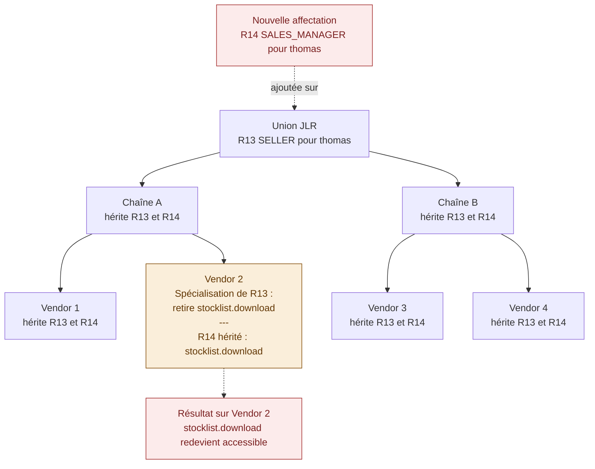
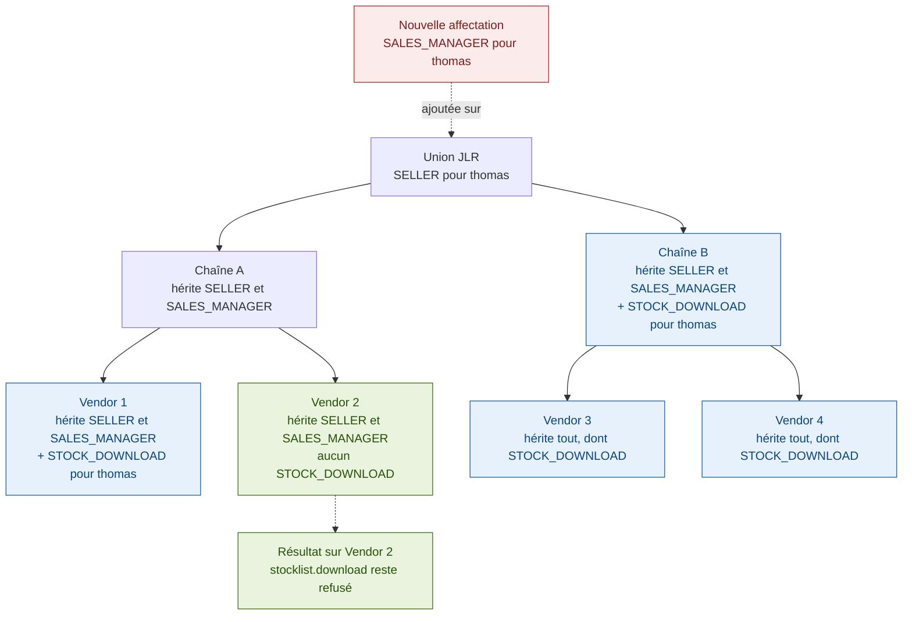

# Problème : l'héritage contourne les restrictions

## En bref

- Un rôle affecté sur un noeud s'applique à tous ses descendants. C'est voulu : une seule affectation sur l'union couvre tous ses points de vente, y compris les futurs.
- Pour retirer une permission sur un point de vente précis, la spec prévoit une spécialisation du rôle sur ce noeud. Par exemple, R13 SELLER spécialisé sur Vendor 2, sans stocklist.download.
- Cette restriction est attachée à un rôle, pas au noeud. Elle ne protège donc que contre ce rôle.
- Si on affecte plus tard sur l'union un autre rôle qui porte la même permission, ce rôle descend complet jusqu'à Vendor 2, et les permissions s'additionnent.
- Résultat : l'utilisateur retrouve stocklist.download sur Vendor 2, alors que personne n'a modifié la restriction. Le contournement ne vient pas d'une erreur de saisie, il découle mécaniquement du modèle.
- Le même effet se produit si une permission est ajoutée plus tard à un rôle global : elle descend sur tous les noeuds spécialisés qui ne l'ont pas explicitement retirée.

## Illustration

En rouge : la nouvelle affectation et son effet. En orange : le noeud spécialisé.

## Rôles et permissions de l'exemple

| Rôle | Permissions |
|---|---|
| R13 SELLER | stocklist.download, quote.create, customer.edit |
| R14 SALES_MANAGER (nouvelle affectation) | stocklist.download, request.approve |
| Spécialisation de R13 sur Vendor 2 | retire stocklist.download |

## Ce qui se passe sur Vendor 2

| Étape | Rôles reçus sur Vendor 2 | stocklist.download |
|---|---|---|
| Avant | R13 spécialisé | Refusé |
| Après l'affectation de R14 sur l'union | R13 spécialisé + R14 hérité complet | **Autorisé** |

Les permissions indiquées sont simplifiées pour l'exemple et doivent être alignées sur le catalogue réel.

# Solution : des rôles qui s'additionnent, sans retrait

On ne retire plus aucune permission sur un noeud, il n'y a donc plus de spécialisation. Une affectation reste simple : un utilisateur, un rôle et un noeud. Elle vaut pour ce noeud et pour tous ses descendants.

Chaque permission sensible est isolée dans un petit rôle à part. Dans l'exemple, le téléchargement du stock n'existe que dans STOCK_DOWNLOAD, et dans aucun autre rôle. Pour qu'un point de vente n'ait pas cette permission, il suffit de ne pas poser STOCK_DOWNLOAD au-dessus de lui et de le donner uniquement là où il est autorisé.

Un rôle affecté plus tard sur l'union ne peut plus ramener le téléchargement sur Vendor 2, puisqu'il ne le contient pas. La restriction tient sans aucun mécanisme de retrait, et ce que l'on lit dans les affectations correspond exactement à ce que l'utilisateur obtient.

## Illustration

Même hiérarchie et même nouvelle affectation que dans le problème. En rouge, la nouvelle affectation. En bleu, les noeuds où le téléchargement du stock est accordé. En vert, le noeud protégé.

## Rôles et permissions

| Rôle | Permissions |
|---|---|
| SELLER | quote.create, customer.edit |
| SALES_MANAGER (nouvelle affectation) | request.approve |
| STOCK_DOWNLOAD | stocklist.download |

## Affectations de thomas

| Rôle | Noeud | Portée |
|---|---|---|
| SELLER | Union JLR | Tous les points de vente de l'union |
| SALES_MANAGER | Union JLR | Tous les points de vente de l'union (nouvelle affectation) |
| STOCK_DOWNLOAD | Vendor 1 | Vendor 1 uniquement |
| STOCK_DOWNLOAD | Chaîne B | Vendor 3, Vendor 4 et les futurs points de vente de la chaîne B |

## Ce qui se passe sur Vendor 2

| Étape | Rôles reçus sur Vendor 2 | stocklist.download |
|---|---|---|
| Avant | SELLER | Refusé |
| Après l'affectation de SALES_MANAGER sur l'union | SELLER et SALES_MANAGER | Toujours refusé |

## Ce que la solution demande

Elle repose sur une règle de catalogue simple : une permission sensible n'appartient qu'à un seul rôle. Cette règle peut être contrôlée automatiquement en base.

Un point de vente ajouté plus tard sous la chaîne A ne reçoit pas le téléchargement du stock tant qu'on ne le lui donne pas. Le comportement est donc fermé par défaut.

Une restriction locale se traite en affectant le petit rôle plus bas, uniquement là où il est autorisé. Le coût dépend du nombre de restrictions qui existent réellement, chiffre à confirmer avec le métier.

Les permissions sont simplifiées pour l'exemple et seront alignées sur le catalogue réel.

