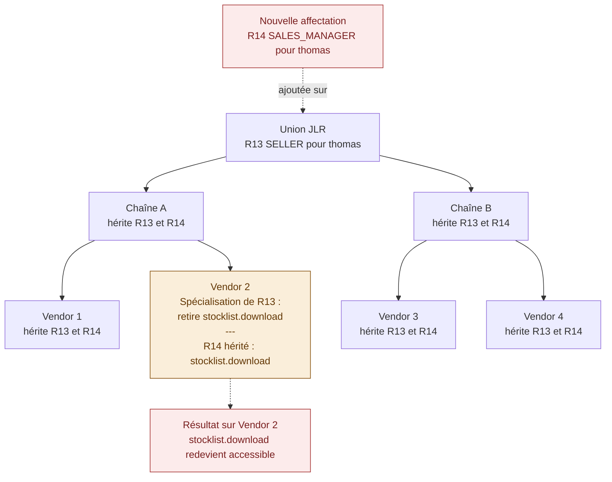

# Problème : l'héritage contourne les restrictions

## En bref

- Un rôle affecté sur un noeud s'applique à tous ses descendants. C'est voulu : une seule affectation sur l'union couvre tous ses points de vente, y compris les futurs.
- Pour retirer une permission sur un point de vente précis, la spec prévoit une spécialisation du rôle sur ce noeud. Par exemple, R13 SELLER spécialisé sur Vendor 2, sans stocklist.download.
- Cette restriction est attachée à un rôle, pas au noeud. Elle ne protège donc que contre ce rôle.
- Si on affecte plus tard sur l'union un autre rôle qui porte la même permission, ce rôle descend complet jusqu'à Vendor 2, et les permissions s'additionnent.
- Résultat : l'utilisateur retrouve stocklist.download sur Vendor 2, alors que personne n'a modifié la restriction. Le contournement ne vient pas d'une erreur de saisie, il découle mécaniquement du modèle.
- Le même effet se produit si une permission est ajoutée plus tard à un rôle global : elle descend sur tous les noeuds spécialisés qui ne l'ont pas explicitement retirée.

## Illustration

En rouge : la nouvelle affectation et son effet. En orange : le noeud spécialisé.

## Rôles et permissions de l'exemple

| Rôle | Permissions |
|---|---|
| R13 SELLER | stocklist.download, quote.create, customer.edit |
| R14 SALES_MANAGER (nouvelle affectation) | stocklist.download, request.approve |
| Spécialisation de R13 sur Vendor 2 | retire stocklist.download |

## Ce qui se passe sur Vendor 2

| Étape | Rôles reçus sur Vendor 2 | stocklist.download |
|---|---|---|
| Avant | R13 spécialisé | Refusé |
| Après l'affectation de R14 sur l'union | R13 spécialisé + R14 hérité complet | **Autorisé** |

Les permissions indiquées sont simplifiées pour l'exemple et doivent être alignées sur le catalogue réel.
